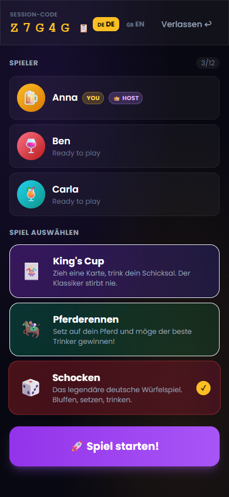
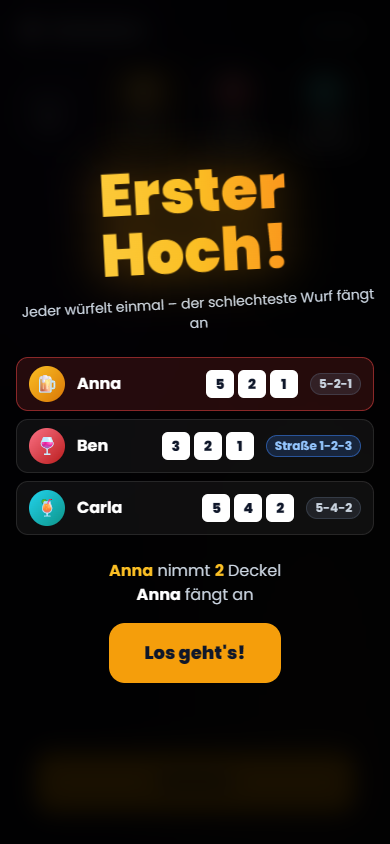
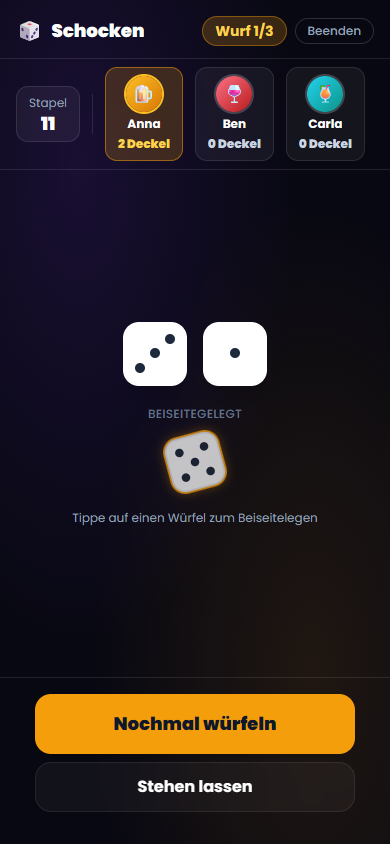
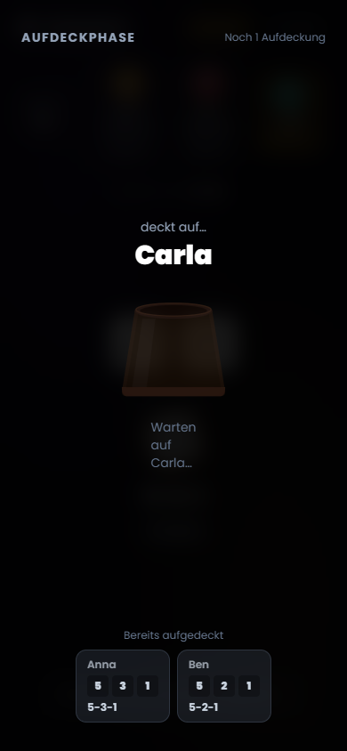
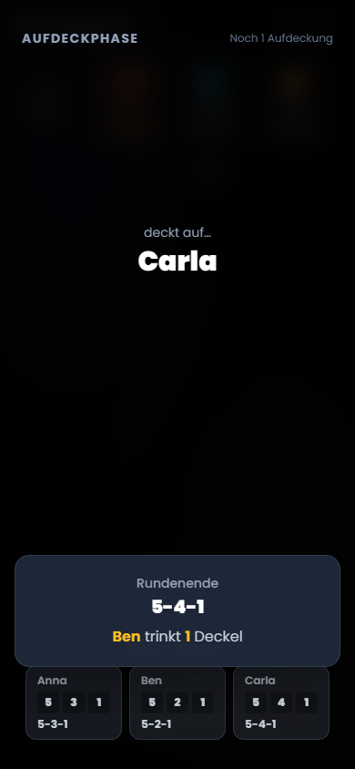

# OneMore 🍻

A multiplayer party-game platform for drinking games. Friends join a shared lobby with a five-letter code on their phones and play together in real time.

| Game | Status |
|---|---|
| 🎲 **Schocken** | Playable — the classic German dice game |
| 🃏 King's Cup | Playable |
| 🏇 Horse Racing | Planned |

> The in-game UI is currently German.

## How Schocken works

<table>
  <tr>
    <td align="center"><br><sub>1. Lobby</sub></td>
    <td align="center"><br><sub>2. Erster Hoch</sub></td>
    <td align="center"><br><sub>3. Rolling</sub></td>
    <td align="center"><br><sub>4. Reveal phase</sub></td>
    <td align="center"><br><sub>5. Round result</sub></td>
  </tr>
</table>

1. **Lobby** — the host creates a session, shares the code and picks a game.
2. **Erster Hoch** — every player automatically throws once. This opening round already counts: the worst throw takes the lids and starts the game.
3. **Rolling** — each player gets up to three rolls. Hold the cup to lift it, tap dice to set them aside, or choose *Stehen lassen* to keep your hand hidden. The first player's number of rolls is the limit for everyone else in that round.
4. **Reveal phase** — once everyone is done, the hidden cups are lifted one after another.
5. **Round result** — the worst hand takes as many lids as the best hand is worth, and starts the next round.

**Hands** (best to worst): Schock Out `1-1-1` (all lids) › Schock `1-1-X` (X lids) › Jule `1-2-4` (7) › General `X-X-X` (3) › Straße (2) › any other throw (1). Jule, General and Straße only count if no dice were set aside.

All 13 lids start on a central stack. Once it is empty, the loser takes lids from the round winner instead, and players without lids drop out. Whoever ends up holding all 13 lids loses.

## Tech stack

- **Backend:** Kotlin, Spring Boot 4, Spring Data JPA (H2 in dev, PostgreSQL in prod), custom JWT auth, STOMP over WebSocket
- **Frontend:** React 18, TypeScript, Vite 6, Tailwind CSS, Framer Motion, `@stomp/stompjs`
- **Tests:** JUnit 5 + Mockito (backend), Vitest + Testing Library (frontend)

State changes go through the REST API (`/api/v1`). Every client receives live game events on a per-session WebSocket topic.

## Setup

**Prerequisites:** JDK 20 and Node.js 18+.

> `gradle.properties` points `org.gradle.java.home` to a local JDK path. Adjust it to your machine, or remove it to use your default JDK.

```bash
# Backend — http://localhost:8080 (dev profile, in-memory H2 database)
./gradlew bootRun

# Frontend — http://localhost:5173 (proxies /api and /ws to the backend)
cd frontend
npm install
npm run dev
```

Open http://localhost:5173 in several browser windows or on several devices to play with multiple players.

**Tests**

```bash
./gradlew test                    # backend
cd frontend && npm run test:run   # frontend
```

**Production** — build the backend jar and the frontend bundle, then start everything with Docker Compose (PostgreSQL, backend, nginx):

```bash
./gradlew build
cd frontend && npm run build && cd ..
DB_PASSWORD=... JWT_SECRET=... docker compose up -d
```

`JWT_SECRET` must be at least 32 characters long.
